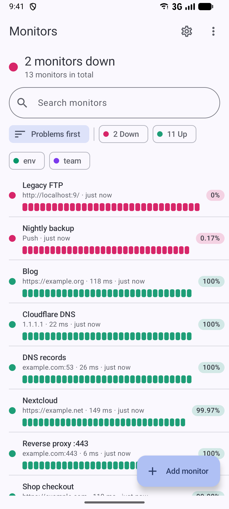
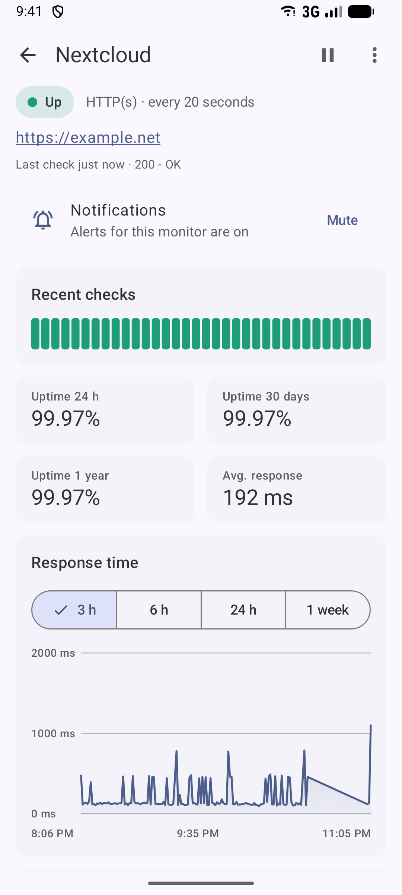
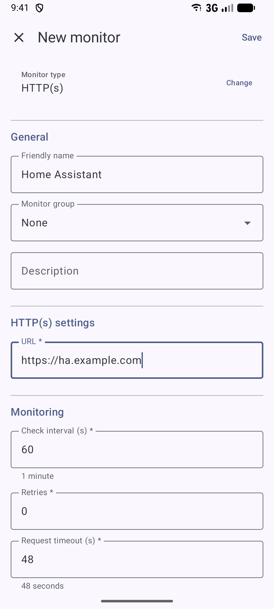
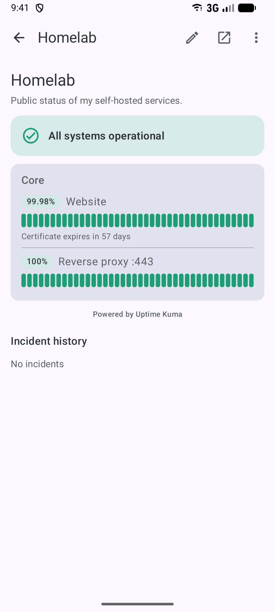
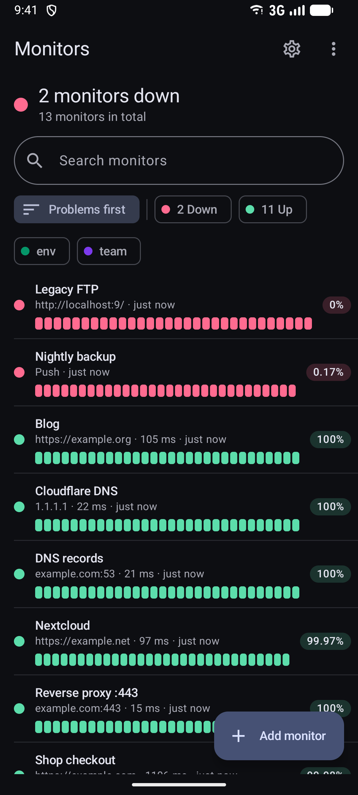

<div align="center">


# Uptime Kuma for Android

**Your self-hosted [Uptime Kuma](https://github.com/louislam/uptime-kuma), native on your phone.**<br>
Live status, full management and instant alerts when something goes down,
delivered through infrastructure you run yourself.

[](https://github.com/kirkanos/uptime-kuma-android/actions/workflows/ci.yml)
[](https://github.com/kirkanos/uptime-kuma-android/releases)
[](LICENSE)
[](#requirements)
[](#compatibility)

[Install](#install) · [Push alerts](#push-alerts) · [Features](#features) · [Privacy](#privacy) · [Build](#build-from-source)

<br>







</div>

---

## Why this app

- **Native and light.** Kotlin, Jetpack Compose and Material 3, about 7 MB. No WebView wrapper, no
  background connection: the app talks to Kuma only while it is open and is woken by push otherwise.
- **Everything Kuma can do.** Not just a status viewer: create and edit monitors of all 34 types,
  maintenance windows, status pages, notification providers and server settings.
- **Alerts without a third-party service.** Kuma pushes straight to your phone through your own
  [ntfy](https://ntfy.sh) server ([UnifiedPush](https://unifiedpush.org), no Google at all) or through
  your own free Firebase project. Nobody else sees your alerts or needs to stay online for them.
- **No tracking.** No analytics, no crash reporting, no ads. Open source under GPLv3.

## Features

| | |
|---|---|
| 📊 **Dashboard** | All monitors with live status, heartbeat bar, uptime, response time; groups, tags, search, "problems first" sorting and filters. Real-time updates over Kuma's Socket.IO API. |
| 🔎 **Monitor details** | Response-time chart (3 h to 1 week), uptime 24 h / 30 d / 1 y, certificate expiry, important events, pause, resume, delete. |
| ✏️ **Monitor editor** | All 34 Kuma monitor types, generated from a spec of Kuma's own form: defaults, validation, conditions, tags, notifications, clone, push URLs. |
| 🔔 **Push alerts** | High-priority notifications for down, recovery and certificate expiry. A DOWN alert rings again until you acknowledge it or the monitor recovers. Per-monitor mute, quiet hours, alert history. Tapping an alert opens the monitor. |
| 🛠️ **Maintenance** | Maintenance windows with every strategy: manual, single, cron and recurring. |
| 🌐 **Status pages** | Rendered view, editor, incidents, and a viewer for any public `/status/<slug>` link without login. |
| ⚙️ **Administration** | All 108 notification providers, general settings, reverse proxy and Cloudflare tunnel, password and 2FA, API keys, proxies, Docker hosts, remote browsers, monitor history. |
| 🏠 **Widget and tile** | Home screen widget and Quick Settings tile with the overall status, updated without polling. |
| 🔐 **Login** | Username and password, two-factor authentication (TOTP), servers without authentication, sub-path installations. |
| 🎨 **Design** | Material You with dynamic color, dark mode, English and German. |

## Push alerts

When a monitor goes down, Kuma sends a webhook. The app creates that webhook notification in Kuma for
you during setup (one per device). Choose how it reaches the phone:

```
ntfy:      Uptime Kuma ──► your ntfy server ──► ntfy app ──► Uptime Kuma for Android
Firebase:  Uptime Kuma ──► your FCM relay  ──► Firebase Cloud Messaging ──► Uptime Kuma for Android
```

| | **ntfy (UnifiedPush)** | **Firebase (your own project)** |
|---|---|---|
| Google services | none | Google Play services required |
| Permanent notification | ntfy shows one for its connection (can be hidden) | none |
| Delivery and battery | very good if ntfy may run in the background | best: wakes the app even in Doze |
| You run | an ntfy server | a tiny stateless relay ([`relay/`](relay/), ~10 MB image) |
| Cost | none | none (Firebase Spark plan) |
| APK | `full` and `foss` | `full` |
| Setup guide | "Setup with ntfy" below | [docs/push/firebase-setup.md](docs/push/firebase-setup.md) |

Both options share the same alert handling in the app (mute, quiet hours, history). Switching is one
tap; the old option is removed from Kuma automatically. Without push the app still works and shows
changes while it is open.

<details>
<summary><h3>Setup with ntfy</h3></summary>

1. **ntfy server.** Run ntfy next to Kuma behind your reverse proxy:
   [compose snippet](docs/push/ntfy-compose-snippet.yml), reasoning behind every setting in
   [docs/push/README.md](docs/push/README.md#4-ntfy-server-setup). Keep
   `NTFY_AUTH_DEFAULT_ACCESS=deny-all`.
2. **Users and token.** One identity for Kuma (publishes), one for the phone (reads):

   ```bash
   docker compose exec ntfy sh -c 'NTFY_PASSWORD=... ntfy user add kuma && ntfy access kuma "up*" write-only'
   docker compose exec ntfy sh -c 'NTFY_PASSWORD=... ntfy user add app  && ntfy access app  "up*" read-only'
   docker compose exec ntfy ntfy token add --label kuma-<device> kuma    # tk_... goes into this app
   ```
3. **ntfy app on the phone** ([F-Droid](https://f-droid.org/packages/io.heckel.ntfy/),
   [GitHub](https://github.com/binwiederhier/ntfy-android/releases), Google Play): set your server as
   default server, add the `app` user, allow it to ignore battery optimizations.
4. **This app:** Settings → *Push notifications* → *ntfy (UnifiedPush)*, enter the `tk_...` token,
   choose whether all monitors should alert. The app creates the webhook in Kuma and sends a test alert.
5. **Open ntfy once afterwards.** Android only lets ntfy start its background connection from the
   foreground; the app reminds you.

</details>

## Install

Each release has two APKs with the same package name and signing key, so you can switch by installing
the other one over it:

| APK | Push options | Google libraries |
|---|---|---|
| `uptime-kuma-android-<version>.apk` (**full**) | ntfy or Firebase | Firebase Messaging, inactive until you choose Firebase |
| `uptime-kuma-android-<version>-foss.apk` (**foss**) | ntfy | none at all (checked in CI) |

- **[GitHub Releases](https://github.com/kirkanos/uptime-kuma-android/releases):** download an APK and
  compare it with the `.sha256` file next to it.
- **[Obtainium](https://github.com/ImranR98/Obtainium):** add
  `https://github.com/kirkanos/uptime-kuma-android` as a source to get updates automatically.
- **F-Droid:** metadata is prepared in `fastlane/metadata/android/`, not submitted yet.

Then log in with your Kuma URL, username and password (and 2FA code), and set up push.

<details>
<summary>Verify the signing certificate</summary>

The signature stays the same across updates. SHA-256 fingerprint of the signing certificate (check with
`apksigner verify --print-certs` or [AppVerifier](https://github.com/soupslurpr/AppVerifier)):

```
7A:11:2B:64:2B:2D:6F:47:74:EC:1B:3F:41:DC:83:8D:B9:78:3F:E6:73:FB:5F:09:C0:CD:C1:C3:F6:7D:A7:3D
```

</details>

## Requirements

- Android 12 (API 31) or newer.
- Uptime Kuma 2.x, reachable from the phone (developed and tested against 2.5.8).
- For push alerts: an ntfy server, or Google Play services plus your own free Firebase project and the
  relay. See [Push alerts](#push-alerts).

## Compatibility

Every pull request runs integration tests against real Uptime Kuma containers.

| Uptime Kuma | Status |
|---|---|
| 2.5.x | ✅ supported, reference version (2.5.8) |
| 2.4.x | ✅ works; fields only 2.5 knows are dropped automatically when saving monitors (33 of 34 types, SFTP needs 2.5.4) |
| 2.0 – 2.3 | ⚠️ untested, allowed |
| 1.x | ❌ not supported, rejected at login |

## Privacy

The app talks only to the servers you configure: your Uptime Kuma instance and, for push, your ntfy
server or your relay and Firebase project. With ntfy nothing leaves the triangle phone, Kuma and ntfy;
with Firebase the alert text passes Google's FCM servers. Firebase is only initialized after you choose
it (no automatic initialization, no Analytics), and the `foss` APK contains no Google library at all.
Session token, ntfy token and relay token are encrypted with the Android Keystore and excluded from
backups.

## Build from source

Needs a JDK 17+ to start Gradle (the build runs on an auto-provisioned JDK 21) and the Android SDK
(platform 37).

```bash
./gradlew assembleFullDebug assembleFossDebug              # debug APKs
./gradlew ktlintCheck detekt lintFullDebug testDebugUnitTest  # checks and unit tests
./gradlew assembleRelease -PsignReleaseWithDebugKey=true   # minified release, local testing only
```

Details on flavors, signing, releases and CI: [BUILD.md](BUILD.md). Architecture:
[docs/architecture.md](docs/architecture.md). Kuma's Socket.IO API as used by the app:
[docs/kuma-api/](docs/kuma-api/). Performance and baseline profiles:
[docs/performance.md](docs/performance.md).

## Contributing

Issues and pull requests are welcome, see [CONTRIBUTING.md](CONTRIBUTING.md). Security issues:
[SECURITY.md](SECURITY.md). Changes: [CHANGELOG.md](CHANGELOG.md).

## License

[GPL-3.0-or-later](LICENSE). Uptime Kuma is a project by [Louis Lam](https://github.com/louislam);
this app is an independent client and not affiliated with it.
